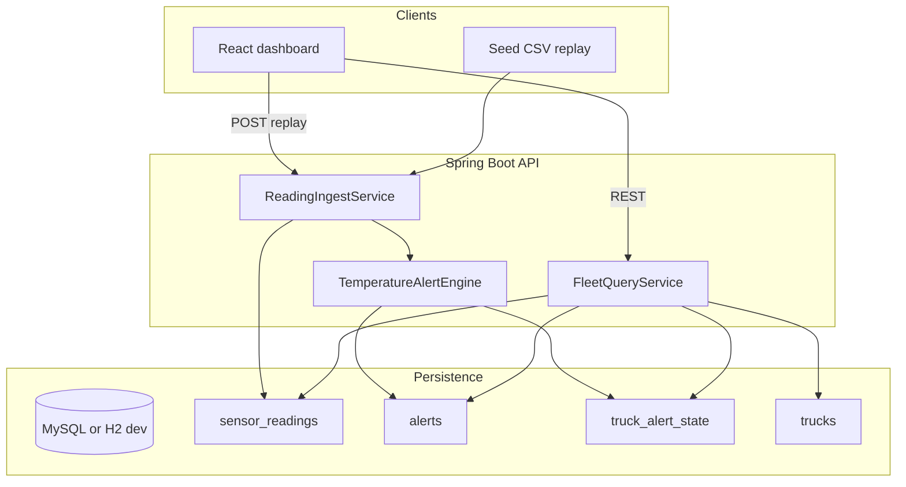

# Nimbus Freight — technical documentation

Sustained temperature alerting for refrigerated (“reefer”) trucks. The system ingests sensor readings, detects **genuine** warm or freeze incidents (not brief blips), avoids duplicate pages for the same ongoing problem, and exposes a small operations dashboard.

**Related docs**

| Document | Audience | Purpose |
| --- | --- | --- |
| [README.md](README.md) | Anyone running the app | Clone layout, quick start |
| [backend/SOLUTION_DESIGN.md](backend/SOLUTION_DESIGN.md) | Hackathon judges | Short problem, assumptions, trade-offs (1–2 pages) |
| This file | Engineers / reviewers | Full technical reference |

---

## 1. Problem statement

Nimbus Freight moves pharma and grocery in temperature-controlled trailers. Sensors report temperature every few minutes. A naive rule—“alert when reading > threshold”—floods dispatch with noise from door openings, defrost cycles, and telemetry jitter. Operators ignore the feed; real spoilage or freeze risk is missed.

**Goals**

- Alert only when a truck has a **sustained** warm or freeze condition.
- **One open alert per truck** at a time (no re-alert fatigue for the same incident).
- Handle **ambiguous** brief requirements explicitly: thresholds, duration, gaps, out-of-order data.
- Provide a **working** ingest → evaluate → API → UI path with seed data for five trucks.

**Non-goals (v1)**

- Auth, multi-tenant, driver notifications, alert ack/snooze, ML anomaly detection, multiple sensors per truck, stale-telemetry alerts.

---

## 2. System architecture



**Repositories**

| Path | Stack | Role |
| --- | --- | --- |
| `backend/` | Java 17+, Spring Boot 3.3, JPA, MySQL | Ingestion, rule engine, REST API |
| `frontend/` | React 18, TypeScript, Vite, Recharts | Fleet status, alerts, temperature charts |

**Processing model**

- **Synchronous**: each accepted reading is persisted, then the alert engine runs in the same transaction (no message queue).
- **Per-truck state**: one row in `truck_alert_state` holds episode timers and pointers to open alerts.
- **Idempotent replay**: duplicate `(truck_id, recorded_at)` is rejected; re-running seed does not duplicate alerts.

---

## 3. Assumptions

These are **documented product choices**, not facts from the customer brief. All thresholds are configurable under `nimbus.alert` in `application.yml`.

### 3.1 Domain

| # | Assumption | Default / behavior |
| --- | --- | --- |
| A1 | Pharma reefers are commonly controlled in a **2–8°C** band | We warn **before** regulatory ceiling (8°C) |
| A2 | **Early warm warning** | Alert path starts at **> 5.0°C**, not at 8°C |
| A3 | **Freeze risk** matters for pharma/grocery | Alert path starts at **< 2.0°C** |
| A4 | **Sustained** means **wall-clock** sensor time | **15 minutes** in violation before OPEN |
| A5 | **Hysteresis** prevents flap | Warm resolves at **≤ 4.0°C** for **10 min**; freeze resolves at **≥ 3.0°C** for **10 min** |
| A6 | Boundaries are strict | Warm: `>` / `≤`; freeze: `<` / `≥` (exactly 5.0°C is not “warm”) |
| A7 | **One OPEN alert per truck** | Opposite sustained violation **supersedes** the open alert |
| A8 | Short opposite blip does **not** resolve open alert | e.g. brief freeze while warm alert is open |
| A9 | **New incident** after RESOLVED is allowed | Second failure next day → new alert |
| A10 | **Gap > 30 min** resets episode timers | Does not bridge “partial warm” across outage; OPEN alerts stay OPEN |
| A11 | **Out-of-order** readings stored, not applied to state | Engine advances only if `recordedAt > lastProcessedAt` |
| A12 | **Invalid** readings rejected | Outside **-50°C … 50°C** or null → HTTP 400, no DB row |
| A13 | **No DATA_STALE alert** in v1 | Silence ≠ temperature violation |
| A14 | **Global policy** | `cargo_type` (PHARMA/GROCERY) stored but does not change thresholds yet |

### 3.2 UI status labels

| Status | Meaning |
| --- | --- |
| `OK` | No open alert, no active episode; latest temp in safe band **3.0–5.0°C** |
| `WARMING` | Above 5°C episode started, sustain not met |
| `FREEZING` | Below 2°C episode started, sustain not met |
| `ALERT_HIGH` / `ALERT_LOW` | Open `HIGH_TEMP` or `LOW_TEMP` alert |
| `WATCH` | Latest temp outside safe band but no episode/alert (e.g. between 5°C and resolve band) |
| `NO_DATA` | No readings yet |

### 3.3 Questions we would ask the customer

- Per-shipment set points vs fleet-wide 2–8°C?
- Target time-to-call-driver after sustained violation?
- Equal priority for freeze vs warm for grocery?
- Policy when telemetry is missing for 45+ minutes?

---

## 4. Alert logic (technical)

**Core class:** `com.nimbusfreight.engine.TemperatureAlertEngine`

Two parallel **tracks** per reading: warm (`HIGH_TEMP`) and freeze (`LOW_TEMP`). Each track maintains:

- Episode start time (`warm_since` / `freeze_since`)
- Resolve window start (`warm_resolve_since` / `freeze_resolve_since`)
- Running extreme (`warm_peak` / `freeze_min`) while episode or alert is active
- Optional open alert id (`open_high_alert_id` / `open_low_alert_id`) — only one non-null open alert enforced at create time via supersede

**Gap handling (before tracks run)**

```text
if (recordedAt - lastProcessedAt) > gapResetMinutes:
    clear episode timers only (warm_since, freeze_since, resolve timers, peaks)
    # open alert ids unchanged — incident stays visible until resolve/supersede
```

**Warm track (simplified)**

1. If `temp > thresholdHigh` → start/continue warm episode; update peak; open alert if sustained and no open high alert; supersede open low if opening high.
2. If open high and still warm → update `peak_temp_c` on alert row only.
3. If open high and `temp <= thresholdHighResolve` (and not in sustained opposite violation) → accumulate resolve duration → RESOLVED `NORMAL`.
4. If no open high and not warm → clear warm episode timers.

**Freeze track** is symmetric with `< thresholdFreeze` and `>= thresholdFreezeResolve`.

**Supersede**

When opening a new alert type while the opposite type is OPEN → resolve opposite with `resolution_reason = SUPERSEDED`, then create new alert with `started_at` = episode start time.

**Persistence hook**

`ReadingIngestService` implements ingest; `AlertSink` is implemented by an inner `PersistingSink` that writes `alerts` and calls `AlertSummaryService` on create.

---

## 5. Design trade-offs

| Decision | Chosen approach | Alternative | Why chosen |
| --- | --- | --- | --- |
| Sustain detection | **Duration** (15 min event time) | N consecutive readings | Sensor interval varies (“every few minutes”) |
| Threshold model | **Separate trigger + resolve** (hysteresis) | Single threshold | Avoid OPEN/RESOLVED flapping near boundary |
| Warm vs freeze | **Dual tracks**, one OPEN alert | Two simultaneous OPEN alerts | Simpler ops inbox; supersede handles rare swing |
| Gap in telemetry | **Reset episode timers** | Interpolate or bridge duration | Unknown cargo state during outage; conservative |
| Out-of-order | **Store all, process in order** | Drop late packets | Charts stay complete; state stays consistent |
| Processing | **Sync in API** | Kafka / stream processor | Hackathon scope; replay proves correctness |
| AI | **Optional text rewrite only** | ML decides alert | Judges see clear rules; AI is bonus signal |
| Database | **MySQL prod**, **H2 `dev` profile** | MySQL only | Local run without Docker |

---

## 6. Data model

| Table | Purpose |
| --- | --- |
| `trucks` | `id`, `name`, `cargo_type` — seeded (NF-01 … NF-05) |
| `sensor_readings` | `truck_id`, `temperature_c`, `recorded_at`; unique `(truck_id, recorded_at)` |
| `alerts` | `type` (`HIGH_TEMP`/`LOW_TEMP`), `status`, `started_at`, `resolved_at`, `peak_temp_c`, `min_temp_c`, `resolution_reason`, `message` |
| `truck_alert_state` | Per-truck engine state: last processed time, episode timers, open alert ids |

Schema applied via `schema.sql` on startup (`spring.sql.init.mode=always`).

---

## 7. API reference

Base URL: `http://localhost:8080` (CORS allows `http://localhost:5173`).

| Method | Path | Description |
| --- | --- | --- |
| `GET` | `/api/trucks` | All trucks with status, latest temp, optional `openAlert` |
| `GET` | `/api/trucks/{id}` | Single truck summary |
| `GET` | `/api/trucks/{id}/readings` | Chart history (`from`, `to` optional ISO-8601) |
| `GET` | `/api/alerts` | Alerts; optional `status`, `truckId` (OPEN first) |
| `GET` | `/api/policy` | Active threshold configuration |
| `POST` | `/api/readings` | Body: `{ truckId, temperatureC, recordedAt }` |
| `POST` | `/api/admin/replay-seed` | Load `data/seed/readings.csv` in timestamp order |

**Ingest results** (`POST /api/readings`): `PROCESSED`, `DUPLICATE`, `STORED_OUT_OF_ORDER`.

---

## 8. Frontend

- **Dashboard**: truck cards, status badges, alerts panel, **Replay seed data** button.
- **Truck detail**: Recharts line chart with reference lines at 2 / 3 / 4 / 5°C; incident list.
- Vite dev server proxies `/api` → `8080`.
- Polls every **10 seconds** (no WebSockets in v1).

---

## 9. Configuration

**Production (default `application.yml`)**

- MySQL: `jdbc:mysql://localhost:3306/nimbus`, user/password `nimbus`
- Seed file: `data/seed/readings.csv` (also on classpath under `src/main/resources/seed/`)

**Local without Docker (`dev` profile)**

```powershell
$env:SPRING_PROFILES_ACTIVE = "dev"
.\mvnw.cmd spring-boot:run
```

Uses embedded H2 file DB at `backend/.data/nimbus-dev` (`application-dev.yml`).

**Optional alert summaries**

- Env: `LLM_API_KEY` (falls back to `OPENAI_API_KEY` if unset)
- Default endpoint: OpenAI `gpt-4o-mini` at `https://api.openai.com/v1`
- DeepSeek: set the key and `SPRING_PROFILES_ACTIVE=deepseek` (`application-deepseek.yml` uses `deepseek-chat` at `https://api.deepseek.com/v1`)
- On alert create, rewrites the template sentence; failures fall back to deterministic text.
- **Does not** affect whether an alert fires.

---

## 10. Seed scenarios (demo)

File: `backend/data/seed/readings.csv`

| Truck | Scenario |
| --- | --- |
| NF-01 Aurora | Warm blip (no alert); freeze blip in progress → **FREEZING** |
| NF-02 Borealis | Sustained warm → resolved → second warm → **OPEN** |
| NF-03 Cirrus | Freeze blip; then sustained freeze → **OPEN LOW_TEMP** |
| NF-04 Drift | Warm spell broken by 45 min gap (no alert); short warm-up → **WARMING** |
| NF-05 Ember | Early spike ignored; sustained warm; duplicate timestamp; 999°C rejected |

---

## 11. Testing

```powershell
cd backend
.\mvnw.cmd test
```

| Suite | Coverage |
| --- | --- |
| `TemperatureAlertEngineTest` | Blips, sustain, boundaries, hysteresis, gap reset, supersede, second incident |
| `FleetBehaviorTest` | Full seed replay, idempotent replay, duplicate, OOO, invalid |
| `AlertSummaryServiceTest` | Template fallback without API key |

---

## 12. Known limitations & future work

- No stale-telemetry (`DATA_STALE`) alert.
- Defrost cycles longer than sustain window will alert (by design until pattern rules exist).
- Per-cargo thresholds, webhooks/SMS, operator workflow, streaming ingest, multi-sensor fusion.
- Parent folder is not a git repo; `backend` and `frontend` are separate repositories.

---

## 13. Component map (backend)

| Package / class | Responsibility |
| --- | --- |
| `config.AlertPolicy` | Thresholds and durations from YAML |
| `engine.TemperatureAlertEngine` | Pure rule evaluation |
| `service.ReadingIngestService` | Validation, dedupe, OOO, engine + persist |
| `service.SeedReplayService` | CSV load, global sort, replay |
| `service.FleetQueryService` | Aggregated truck status and alerts |
| `service.AlertSummaryService` | Optional LLM message |
| `web.FleetController` | REST surface |
